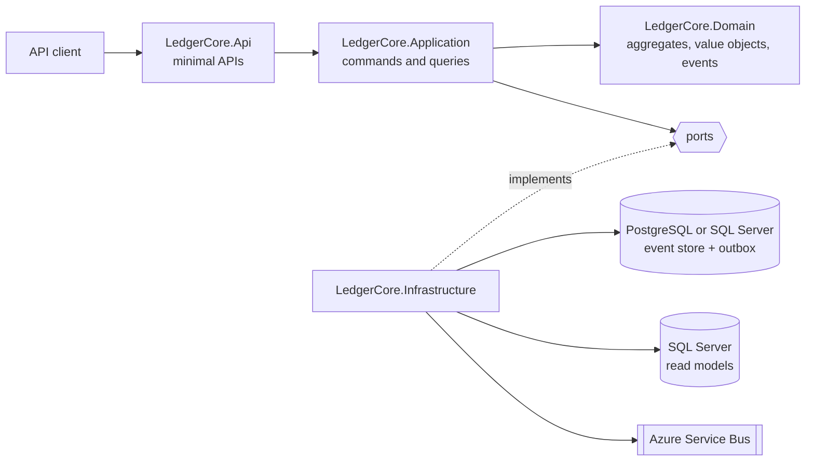
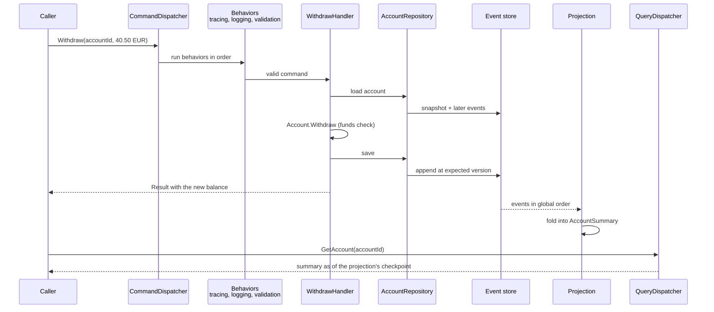
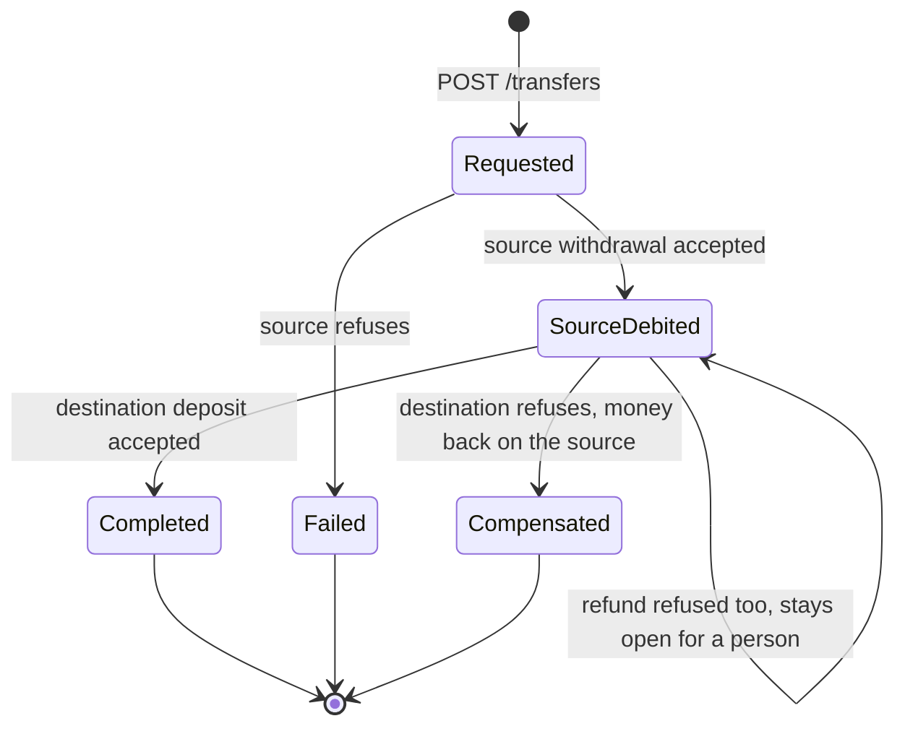

# LedgerCore

[](https://github.com/softvasco/ledger-core/actions/workflows/ci.yml)
[](LICENSE)

An event-sourced, double-entry banking ledger in .NET 10. Every movement debits one account and credits another, nothing is ever updated in place, and any balance can be rebuilt from the events that produced it.

Work in progress. The domain model, the event store (PostgreSQL or SQL Server), the command and query layer and the HTTP API are in place; the transactional outbox is next.

## Why

In a lot of banking software the balance is a column that gets overwritten, and the audit trail is a separate table you hope is complete. When a number looks wrong, working out how it got there is slow and painful.

A ledger built on events turns that around. The events are the record, the balance is derived from them, and the history is the same thing as the audit. Double entry adds the rule that money never appears or disappears: for every posting, debits equal credits.

This repo is my take on how that should look in modern .NET, without a framework hiding the interesting parts.

## Features

Done:
- `Money` and `Currency` value objects: no mixing currencies, no amounts finer than the currency settles in, banker's rounding on multiplication.
- `Iban` with per-country length and mod-97 check, and a strongly typed `AccountId` (time-ordered v7 Guid).
- `Account` aggregate (open, freeze, unfreeze, close) built from its events on a small aggregate root with versioning.
- Journal entries of two or more postings that must balance in every currency, checked with FsCheck property tests ([ADR-0004](docs/adr/0004-double-entry-bookkeeping-model.md)).
- Business rule failures come back as `Result` with stable error codes; exceptions are kept for bugs ([ADR-0003](docs/adr/0003-results-for-business-rule-failures.md)).
- Event store on a single table: optimistic concurrency per stream, and a global position that readers can follow without skipping a late commit. It runs on PostgreSQL or SQL Server and both pass the same contract tests. Positions come from an identity column that is assigned before commit, so appends take a lock first: an advisory lock on PostgreSQL, `sp_getapplock` on SQL Server.
- Snapshots every N events (100 by default). They are only a cache: a missing or unreadable snapshot just means a longer replay.
- Benchmarks for appends and stream reads, with the results in [docs/performance.md](docs/performance.md).
- Commands and queries through a small hand-written dispatcher, one handler per message ([ADR-0007](docs/adr/0007-own-command-and-query-dispatcher.md)). Commands run through tracing, logging and validation behaviors; validation reports every error at once.
- Deposit and Withdraw with the balance kept on the account stream, so two racing withdrawals can't both pass the funds check ([ADR-0006](docs/adr/0006-balance-on-the-account-stream.md)).
- An account read model built by a pure projection that follows the store's global position.
- Account endpoints on a minimal API. Every error is an RFC 9457 problem with a stable `code` to branch on, for example a 409 with `account.insufficient_funds` when a withdrawal is more than the balance ([ADR-0008](docs/adr/0008-problem-details-for-every-error.md)).
- An OpenAPI 3.1 document at `/openapi/v1.json` that lists every status an endpoint can answer, and a Scalar UI at `/scalar` in development.
- `Idempotency-Key` on every POST: a retry gets the stored response back, the same key with another body is a 422 ([ADR-0009](docs/adr/0009-idempotency-keys-for-post.md)). It is an endpoint filter, so callers that run the endpoint in-process get it too ([ADR-0010](docs/adr/0010-idempotency-as-an-endpoint-filter.md)).
- Transfers between accounts run as a process manager over the two account streams: debit the source, credit the destination, and give the money back if the destination refuses ([ADR-0011](docs/adr/0011-transfers-as-a-process-manager.md)). `POST /transfers` answers 201 with the final status, or the refusing account's problem plus a `transferId` to read it back from `GET /transfers/{id}`. A retry with the same `Idempotency-Key` gets the first answer and moves the money once.
- What counts as the API contract, which changes break it, and how a v2 would sit next to v1: [docs/api.md](docs/api.md).

Coming next:
- Transactional outbox (built on outbox-kit), then Azure Service Bus.
- Read models on SQL Server, .NET Aspire, OpenTelemetry, and a Blazor back office.

## Architecture



The Domain project has no dependencies at all. Application talks to the outside world only through interfaces it owns, and Infrastructure implements them. Design decisions are in [docs/adr](docs/adr/README.md), starting with [why the ledger is event sourced](docs/adr/0002-event-sourcing-for-the-ledger.md).

## How a command and a query flow



The write side answers from the account stream, so a withdrawal never sees a stale balance. The read side catches up after the append and can lag behind it; a query returns whatever the projection has seen so far.

## How a transfer runs



Each arrow is one event on the transfer's own stream, saved before the next step starts, so after a crash `TransferProcessManager` picks up at the last recorded state. A refused debit is `Failed` because no money moved. A refused credit is `Compensated` because the source was paid back. If the refund is refused as well, the transfer stays `SourceDebited` and the error is thrown rather than hidden ([ADR-0011](docs/adr/0011-transfers-as-a-process-manager.md)).

## Quickstart

```bash
dotnet build
dotnet test
dotnet run --project src/LedgerCore.Api
```

The API keeps everything in memory for now. Open http://localhost:5174/scalar to open an account, post deposits and withdrawals and move money between accounts, or run the requests in [LedgerCore.Api.http](src/LedgerCore.Api/LedgerCore.Api.http) from VS Code (REST Client) or Visual Studio. They cover each endpoint, a retried deposit, and the main errors.

Needs the .NET 10 SDK, and Docker for the PostgreSQL and SQL Server tests (Testcontainers starts the databases). A one-command run with .NET Aspire comes once there is infrastructure to run.

## License

MIT
